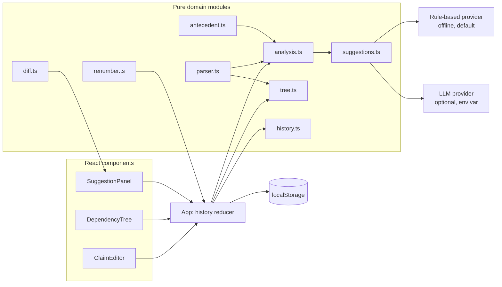

# Patent claim editor with dependency tree and suggestions

A front-end prototype for drafting patent claims. Claims are edited in a numbered list. The app parses each claim live, shows the claim dependency tree beside the editor, flags reference and antecedent-basis problems inline, and offers suggestions that can be accepted or rejected one at a time.

The sample patent is a fictional invention written for this demo. It contains a few deliberate problems so the checks have something to report.

## Problem

Claim sets have a lot of structure that is easy to break while editing:

- Dependent claims refer to earlier claims by number ("The apparatus of claim 1, wherein ..."). A renumbering or a deleted claim silently breaks those references.
- Definite references ("the sensor") need an earlier indefinite introduction ("a sensor") in the same claim or in a claim it depends on. Missing introductions are a common objection.
- Repeated or skipped claim numbers are easy to introduce and hard to spot in a long document.

This prototype makes those relationships visible while the text is being written, and turns the obvious fixes into one-click actions.

## Features

- **Claims editor**: numbered claims with editable numbers, add, delete, and renumber. Claim text is an auto-growing textarea.
- **Live checks with inline highlights**: references to missing or later claims, antecedent-basis problems, duplicate numbers, and numbering gaps. Each issue has a message, and numbering issues have a one-click renumber fix.
- **Dependency tree**: a collapsible tree built from the claim references. Claims with only broken references are shown at the top, marked as unresolved.
- **AI suggestions**: word-level inline diffs with Accept and Reject per suggestion. The rule-based engine runs offline and is the default. An optional LLM provider can be enabled with an environment variable. Accepted changes can be undone and redone.
- **Persistence and export**: the draft is saved to localStorage. Export to plain text or JSON.
- **Keyboard and accessibility**: every control has a label, issues are linked to their textarea with `aria-describedby`, status messages use a live region, and Ctrl/Cmd+Z and Ctrl/Cmd+Shift+Z undo and redo.

## Architecture



The domain modules have no React dependencies and are covered by unit tests. Suggestions are recomputed from the current text on every change. A suggestion is a single edit at a character offset, so accepting one does not depend on any other suggestion still being open. If the text under a suggestion has changed, it is shown as out of date and cannot be applied.

The suggestion provider interface (`SuggestionProvider` in `src/domain/suggestions.ts`) is the seam for the LLM provider. The LLM provider sends claim text to an endpoint and accepts only edits whose `from` text appears exactly in the claim.

## How to run

Requires Node 18 or newer.

```bash
npm install
npm run dev        # dev server on http://localhost:5174
npm test           # single run of the vitest suite
npm run build      # type-check and production build
```

Optional LLM suggestions. Point the app at an OpenAI-compatible chat endpoint. The endpoint should be a proxy you control, so that no API key is placed in the browser bundle:

```bash
VITE_LLM_ENDPOINT=http://localhost:8787/v1/chat/completions VITE_LLM_MODEL=my-model npm run dev
```

The app never reads an API key. Claim text is sent to the endpoint only when you press "Ask LLM for more suggestions".

## Test results

`npm test` runs vitest with jsdom and React Testing Library. Output from the last run on Node 18.19.1:

```
 ✓ src/domain/suggestions.test.ts  (11 tests)
 ✓ src/domain/parser.test.ts  (7 tests)
 ✓ src/domain/analysis.test.ts  (10 tests)
 ✓ src/domain/history.test.ts  (4 tests)
 ✓ src/domain/tree.test.ts  (3 tests)
 ✓ src/App.test.tsx  (5 tests)

 Test Files  6 passed (6)
      Tests  40 passed (40)
```

What the tests cover:

- Claim parsing: reference detection, offsets, pasted-block parsing.
- Antecedent basis: ancestor introductions, same-claim ordering, sibling independence, and the planted issues in the sample.
- Numbering and references: duplicates, gaps, missing and forward references, renumbering with reference rewriting.
- Dependency tree: nesting, unresolved roots, and cycle safety.
- Suggestions: deterministic rule output for the sample, stale detection, accepting a fix removes its issue, LLM response parsing and failure handling with a stubbed `fetch`, word diff reconstruction.
- History: undo/redo and coalescing of keystrokes.
- UI flow: accept then undo, reject then restore, persistence to localStorage, Ctrl+Z.

`npm run build` completes: type-check passes and Vite produces the production bundle.

## Limitations

- The antecedent checker is a word-based heuristic, not a parser. It accepts a reference when any of its words was introduced, which avoids most false positives but misses some real errors. It does not understand claim categories, "one or more" alternatives, or multi-sentence scope.
- Claim references cover "claim N", "claims N and M", and "claims N, M or O". Numeric ranges such as "claims 1 to 3" only report the listed numbers.
- The suggestion engine makes single, local edits. Its wording rules are few and intentionally conservative.
- The LLM provider has been tested only against a stubbed `fetch`, not a live model.
- The highlight layer aligns a mirror div with a transparent textarea. It relies on identical font metrics and was not checked across browsers or zoom levels.
- Only the browser UI was exercised, through jsdom tests. Accessibility was designed in but has not been audited with a screen reader or an automated checker.
- The draft is stored in one browser's localStorage. There is no sharing, versioning, or server.

## Next steps

- Replace the regex-level reference parser with a tokenizer that understands claim ranges and categories.
- Extend antecedent checks with noun-phrase chunking and a per-claim term table shown in the UI.
- Add more rule families (for example, "wherein" clauses and "comprising" versus "consisting of") and a suggestion-quality test set built from fictional claims.
- Add Playwright end-to-end tests and an automated accessibility audit.
- Import and export structured claim formats, and move persistence behind an API.
