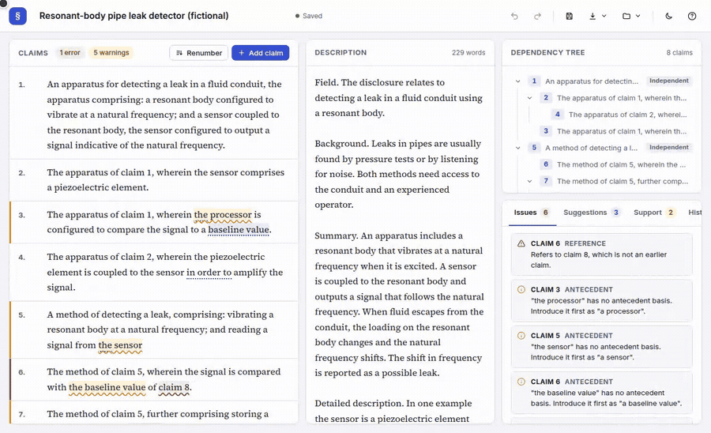
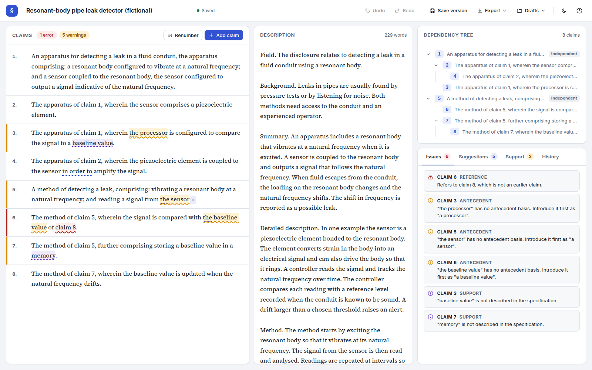
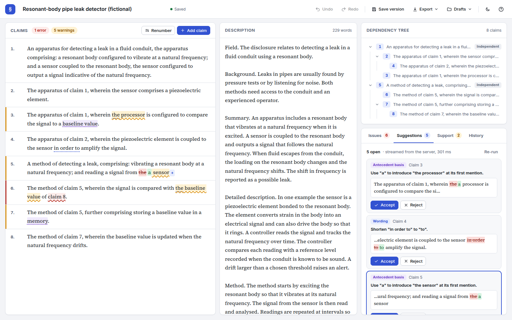
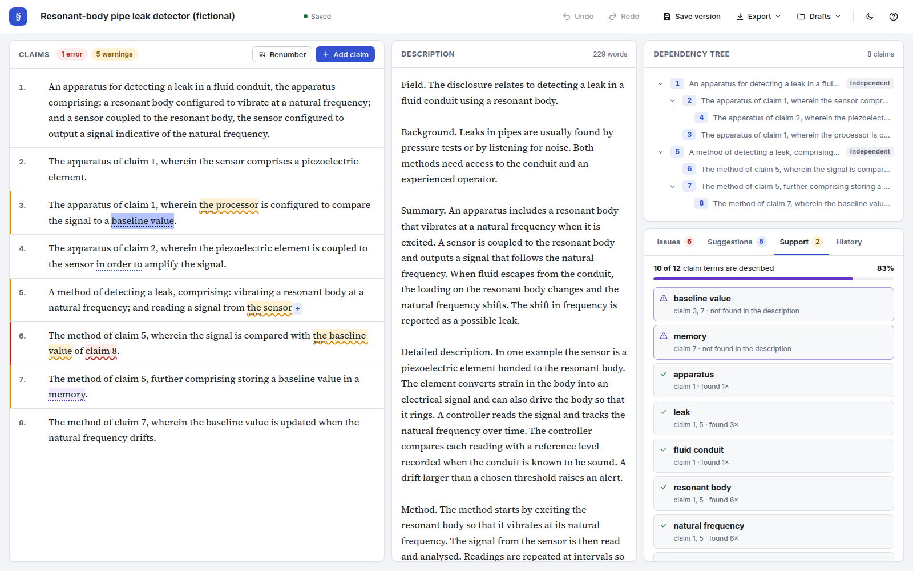
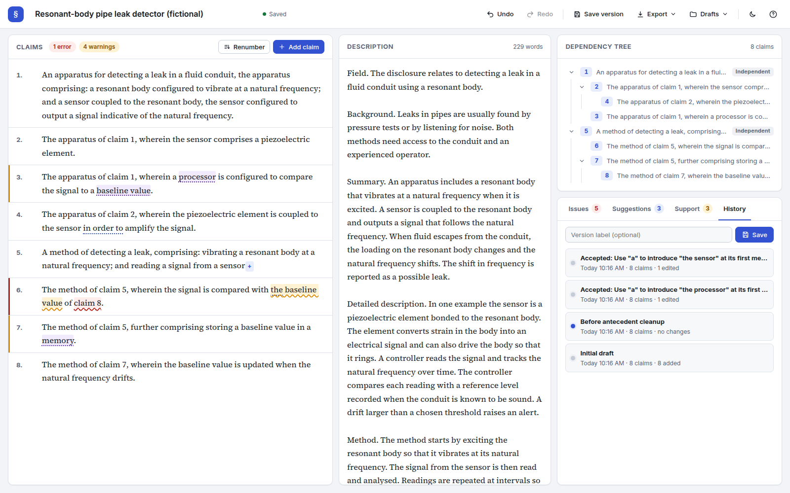
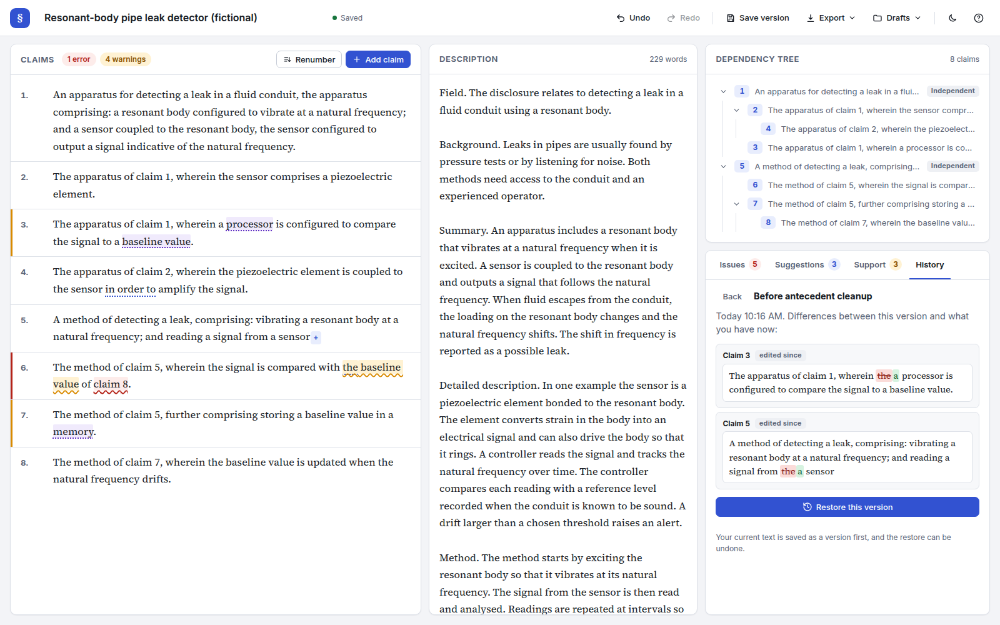
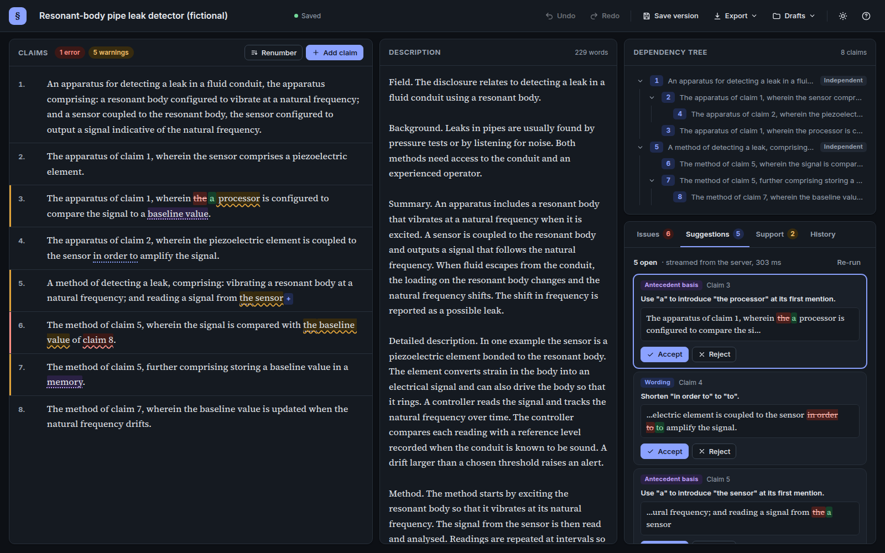
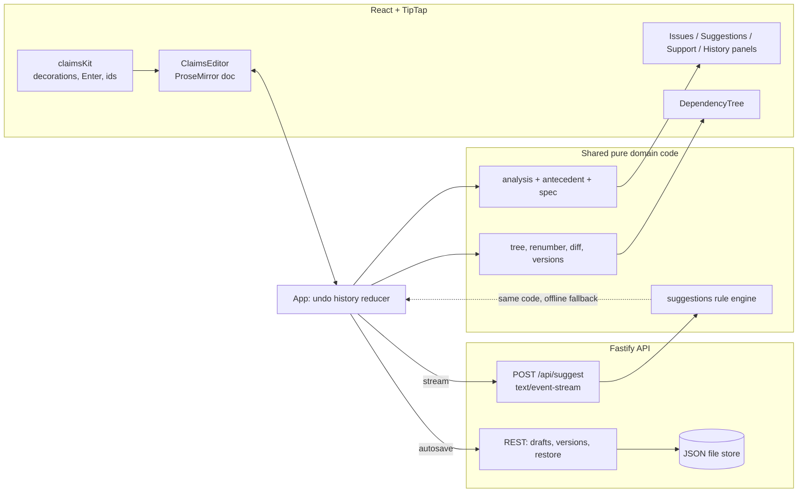

# Patent claim editor with dependency tree and suggestions



*A 19 second walkthrough, recorded with Playwright driving the real app: type a dependent claim, see the inline mark and the tree update, accept a streamed suggestion, fix description support, save a version. ([MP4 version](docs/demo.mp4))*

A full-stack prototype for drafting patent claims. Claims live in a rich-text editor (TipTap on ProseMirror) where each paragraph is one numbered claim. The app parses them live, draws issues and AI suggestions as inline decorations, shows the claim dependency tree, checks that every claim term is described in a second pane, and stores drafts with version history in a small Fastify API that streams suggestions over server-sent events.

The sample patent is a fictional invention written for this demo. It contains deliberate problems so the checks have something to report.

## Screenshots



*Claims, description, dependency tree and issues. Underlines in the claims are the same findings the list shows.*



*The selected suggestion is previewed in the claim (struck text, green insertion) and as an excerpt diff with Accept and Reject.*



*Specification support: terms a claim introduces but the description never uses are listed and marked in the claim.*



*Version history: manual saves and automatic versions created when a suggestion is accepted.*



*Previewing a version shows what changed since, as word diffs, with a restore that is itself undoable.*



*Dark theme (follows the system setting, or the toggle).*

## Problem

Claim sets have a lot of structure that is easy to break while editing:

- Dependent claims refer to earlier claims by number. A renumbering or a deleted claim silently breaks those references.
- Definite references ("the sensor") need an earlier indefinite introduction ("a sensor") in the same claim or in a claim it depends on.
- Every term the claims introduce should be supported by the description.
- Repeated or skipped claim numbers are easy to introduce and hard to spot in a long document.

This prototype makes those relationships visible while the text is being written, and turns the obvious fixes into one-click actions.

## Features

- **Rich-text claims editor.** TipTap/ProseMirror with one paragraph per claim and hanging-indent numbers. Enter starts the next numbered claim. Issues are drawn as ProseMirror decorations (red wavy: reference and numbering errors; amber wavy: antecedent basis; violet dotted: unsupported term). Suggestions are decorations too: the selected one shows struck text and a green insertion in the claim.
- **Live checks.** Missing and forward references, duplicate or missing numbers, numbering gaps, heuristic antecedent basis. One-click renumber rewrites "claim N" references.
- **Dependency tree.** Collapsible, with independent claims and broken references labelled. Clicking a node jumps to the claim.
- **Streamed suggestions.** The deterministic offline rule engine runs on the server and streams one SSE event per edit, so cards appear progressively with a progress bar. Accept, reject and undo are per suggestion. If the server is unreachable the same engine runs in the browser.
- **Specification support.** Write the description in the second pane. Each noun phrase a claim introduces with "a/an" is matched against it (plural-insensitive). Unsupported terms are listed with coverage and marked in the claim.
- **Drafts and version history.** Autosave (debounced) to the API, manual versions with labels, automatic versions when a suggestion is accepted, preview of differences, restore that snapshots the current text first. Drafts menu to switch or create drafts.
- **Keyboard and accessibility.** Undo/redo (Ctrl/Cmd+Z, +Shift+Z), Ctrl/Cmd+S saves a version, F8 jumps between issues, Alt+] / Alt+[ move through suggestions, Alt+Enter accepts, Alt+Backspace rejects, Ctrl/Cmd+/ lists shortcuts. Tabs, dialog and menus are keyboard operable; axe finds no WCAG 2.1 A/AA violations (see below).
- **Polish.** Light and dark themes from design tokens, bundled fonts (Inter, Source Serif 4), empty and offline states, toast messages, and a layout that goes from three panes to one column.

## Architecture



- The domain modules (`src/domain`) have no React or server dependencies. The browser uses them for live analysis; the server imports the same files for suggestions, so results are identical online and offline.
- The editor document is the source of truth for text. Each paragraph is `N. claim text`; the number is parsed from the prefix, so duplicate, missing and skipped numbers are real states to check. Claim ids are stable attributes on the paragraph nodes, kept unique by a ProseMirror plugin.
- Undo/redo is an app-level history of whole documents (so accepted suggestions, restores and renumbering undo like typing). ProseMirror's own history is not loaded.
- Issue and suggestion decorations are pushed into the editor through a transaction meta, mapped through edits between updates, so underlines stay attached to their text while the analysis catches up.
- A suggestion is a single edit at a character offset in one claim. If the text under it changed, it is shown as out of date and cannot be applied.
- The server keeps drafts and versions in one JSON file (atomic rename on write). It serves the built front end, so `npm start` is the whole app.

## How to run

Requires Node 18 or newer.

```bash
npm install
npm run build
npm start          # API and app on http://localhost:8791
```

Development, with hot reload:

```bash
npm run dev:server   # API on http://localhost:8791
npm run dev          # Vite on http://localhost:5174, proxies /api
```

Server settings (environment variables): `PORT`, `HOST`, `DATA_FILE` (default `data/drafts.json`), `STATIC_DIR`, `SUGGEST_DELAY_MS` (pause between streamed suggestions, default 90, set 0 to disable), and optionally `LLM_ENDPOINT` / `LLM_MODEL` for an OpenAI-compatible endpoint. The LLM provider only runs when a request asks for it and the server has an endpoint; no key is ever sent to the browser.

Other commands:

```bash
npm test                 # unit and API tests (vitest)
npm run e2e              # Playwright end-to-end, axe accessibility and performance checks
npm run media:screenshots   # re-record docs/screenshots
npm run demo             # re-record docs/demo.gif (needs python3 for a throwaway ffmpeg venv)
```

Playwright uses its bundled Chromium. To use an installed Chrome instead: `PW_CHANNEL=chrome npm run e2e`.

## API

| Method and path | Purpose |
| --- | --- |
| `GET /api/drafts`, `POST /api/drafts` | List drafts; create one (empty body seeds the sample) |
| `GET/PUT/DELETE /api/drafts/:id` | Read, autosave, delete a draft |
| `GET /api/drafts/:id/versions` | Version summaries, newest first, with change counts |
| `POST /api/drafts/:id/versions` | Save the posted document and snapshot it as a version |
| `GET /api/drafts/:id/versions/:vid` | A full snapshot |
| `POST /api/drafts/:id/versions/:vid/restore` | Snapshot the current draft, then restore the version |
| `POST /api/suggest` | SSE stream of `progress`, `suggestion`, `done` (or `error`) events |

## Test results

Last full run on Node 18.19.1 (Chrome, Linux, a shared machine that was under load while measuring):

| Check | Result |
| --- | --- |
| Type check (`tsc --noEmit`) | clean |
| Unit and API tests (`npm test`) | 56 passed in 10 files: domain logic, spec support, versions, SSE parser, editor document helpers, and the Fastify API (drafts, versions, restore, persistence across restart, SSE stream, determinism, optional LLM stub) |
| End-to-end (`npm run e2e`) | 20 passed: typing and Enter-numbering, live tree and issues, accept/undo, keyboard shortcuts, streaming, spec support, version save/preview/restore, autosave and reload, offline fallback, theme, shortcut dialog, phone width |
| Accessibility (axe-core, WCAG 2.1 A and AA) | 0 violations in light and dark mode on the Issues, Suggestions, Support and History tabs, plus the export menu and the shortcuts dialog |
| Production build | passes |

Axe covers what it can detect automatically (names, roles, contrast, structure). It is not a substitute for a screen-reader pass.

### Performance

Measured with `e2e/perf.spec.ts` on a 100-claim document (dependent claims in several chains):

- Analysis of all checks plus the tree: median 2.4 ms for 100 claims and 12 ms for 500 claims (pure code, 15 runs each).
- Typing in the middle of the 100-claim document, key-down to the second animation frame after it, 69 keystrokes: p50 23 ms, p95 52 ms, max 73 ms.

Two things keep it responsive: antecedent scanning is cached by claim text and inherited terms are memoised per claim (this took 100-claim analysis from about 20 ms to about 4 ms in an earlier run), and the sidebar reads deferred values so typing is not blocked by panel rendering. The editor does not re-render React on every ProseMirror transaction. Before the caching, 500 claims took about 340 ms per analysis.


## Limitations

- The antecedent checker is a word-based heuristic, not a parser. It accepts a reference when any of its words was introduced ("the gasket leaks" passes if "leak" was introduced), which avoids most false positives but misses some real errors.
- Specification support is word matching: a synonym in the description counts as unsupported, and a term mentioned only in passing counts as supported.
- Claim references cover "claim N", "claims N and M", and "claims N, M or O". Ranges such as "claims 1 to 3" only report the listed numbers.
- The LLM provider is tested only against a stubbed `fetch`, not a live model. The default engine is rule-based.
- The API has no authentication, no multi-user conflict handling (last write wins) and a single JSON file as storage. It is a demo backend.
- Accessibility was checked with axe and by keyboard, not with a screen reader.
- Tested in Chromium only.
